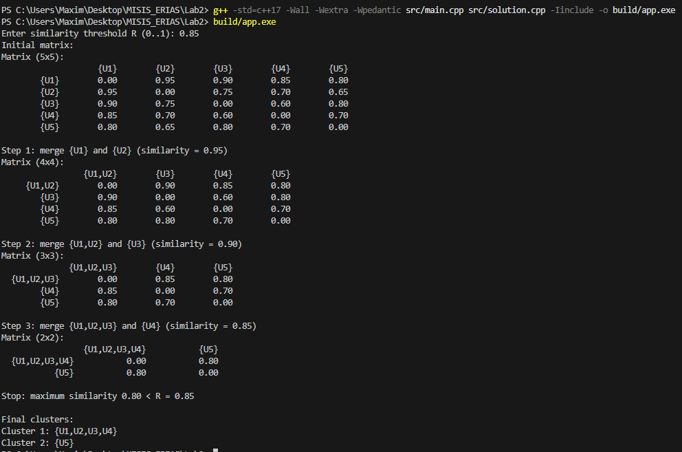

## Сборка

```shell
g++ -std=c++17 src/main.cpp src/solution.cpp -Iinclude -o build/app.exe
```

## Запуск

```powershell
.\build\app.exe
```

При запуске необходимо ввести порог сходства R от 0 до 1.

При R = 0 алгоритм объединяет всех пользователей в один кластер.

Для изменения исходной матрицы редактировать CSV-файл в папке `data`.

## Скриншоты работы программы

### При матрице из примера (R = 0.85)


