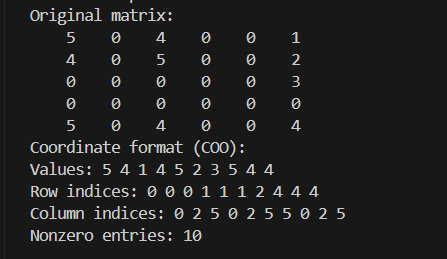
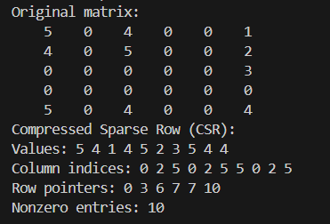
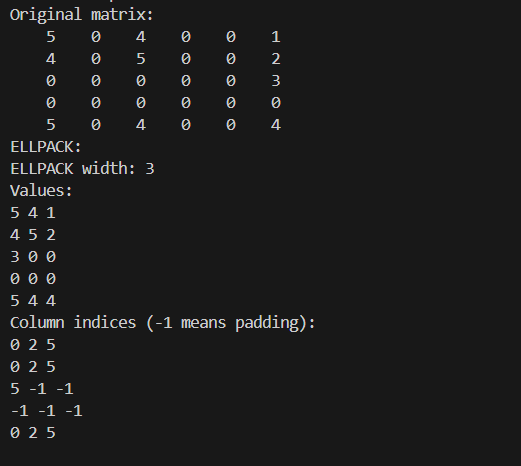
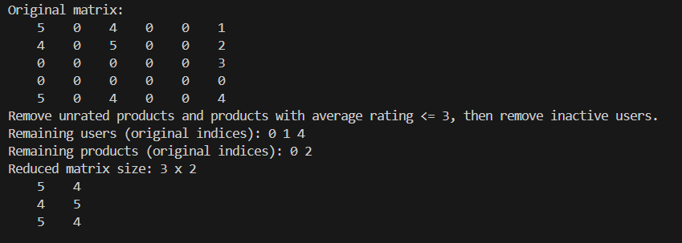

# Лабораторная работа №3

Реализация способов компактного хранения разреженной матрицы предпочтений: COO, CSR, ELLPACK и сокращение размерности.

## Сборка

Из корня проекта:

```shell
mkdir build
g++ -std=c++17 src/main.cpp -Iinclude -o build/app.exe
```

## Запуск

```powershell
.\build\app.exe
```

При запуске отображается меню. Матрицу можно загрузить из файла (пункт 1) или ввести с клавиатуры (пункт 2).

Для ввода матрицы сначала указываются количество строк и столбцов, затем её элементы. Строки соответствуют пользователям, столбцы — товарам. Нули обозначают отсутствие оценки.

Для изменения исходной матрицы можно отредактировать файл `data/matrix.txt`. Первая строка содержит количество строк и столбцов, последующие — элементы матрицы:

```text
5 6
5 0 4 0 0 1
4 0 5 0 0 2
0 0 0 0 0 3
0 0 0 0 0 0
5 0 4 0 0 4
```

Чтобы загрузить матрицу из этого файла, выбрать пункт 1 и указать путь `data/matrix.txt`.

В пунктах 3–5 программа выводит матрицу в форматах COO, CSR и ELLPACK. В пункте 6 выполняется сокращение размерности: удаляются товары со средней оценкой не выше 3 и неактивные пользователи.

## Скриншоты работы программы

### Координатный формат (COO)



### Строчно-индексный формат (CSR)



### ELLPACK



### Сокращение размерности матрицы предпочтений


