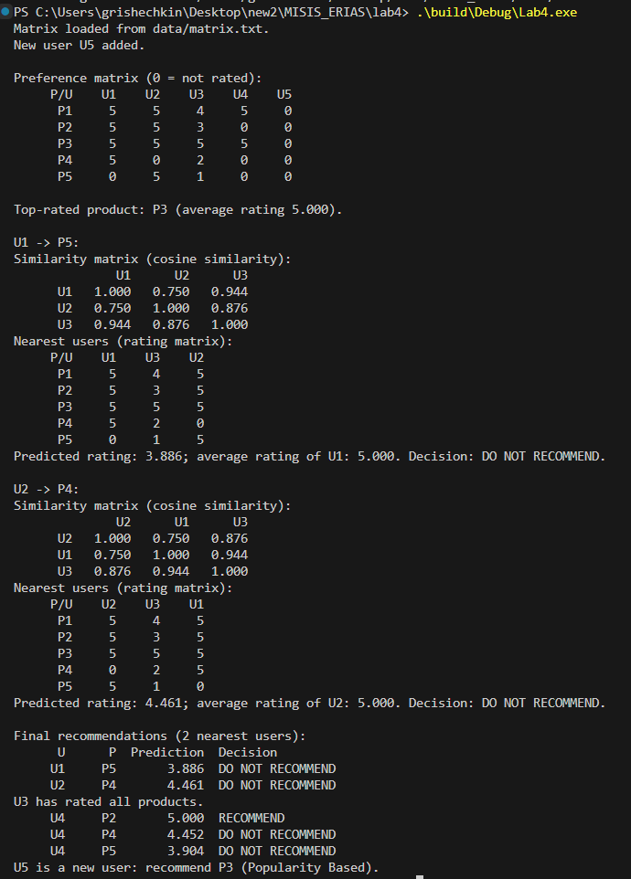

# Лабораторная работа №4

Рекомендация товаров методом **User-Based Collaborative Filtering** на основе косинусного подобия пользователей.

## Сборка и запуск

В терминале из папки `Lab4`:

```powershell
cmake -S . -B build
cmake --build build --config Debug
.\build\Debug\Lab4.exe
```

## Исходные данные

Программа автоматически читает `data/matrix.txt`. Если файла нет, матрицу можно ввести с клавиатуры. Ноль означает отсутствие оценки. Для примера используется матрица из задания:

| Товар | U1 | U2 | U3 | U4 |
|---|---:|---:|---:|---:|
| P1 | 5 | 5 | 4 | 5 |
| P2 | 5 | 5 | 3 | 0 |
| P3 | 5 | 5 | 5 | 5 |
| P4 | 5 | 0 | 2 | 0 |
| P5 | 0 | 5 | 1 | 0 |

Если в матрице нет нового пользователя, программа добавляет U5 с нулевыми оценками.

## Алгоритм

Для каждого неоценённого товара выбираются пользователи, которые его оценили. По косинусному подобию находятся **два ближайших пользователя (Top-2)**. На основе их оценок рассчитывается прогноз. Товар рекомендуется, если прогноз **не ниже средней оценки целевого пользователя**. Для нового пользователя выбирается товар с наибольшей средней оценкой (**Popularity Based**).

Программа выводит исходную матрицу, матрицы сходства и соседей для U1/P5 и U2/P4, прогнозы и итоговые решения. В исходном примере самый рейтинговый товар — **P3 (5.000)**.

## Скриншот работы программы

