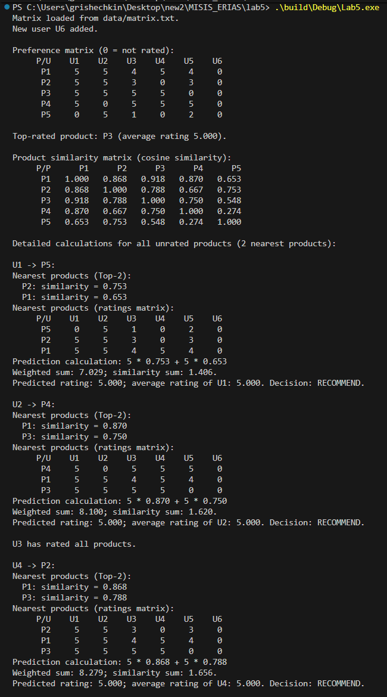
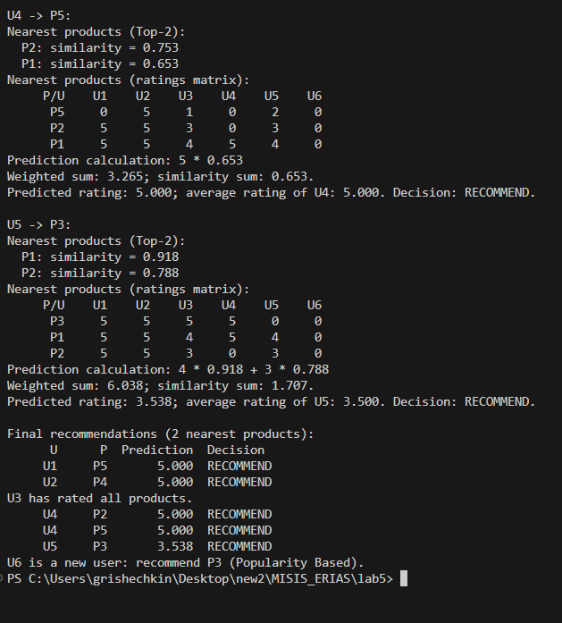

# Лабораторная работа №5

Рекомендация товаров методом **Item-Based Collaborative Filtering** на основе косинусного подобия товаров.

## Сборка и запуск

В терминале из папки `Lab5`:

```powershell
cmake -S . -B build
cmake --build build --config Debug
.\build\Debug\Lab5.exe
```

## Исходные данные

Программа автоматически читает `data/matrix.txt`. Если файла нет, матрицу можно ввести с клавиатуры. `0` означает отсутствие оценки.

В работе используется матрица из задания:

| Товар | U1 | U2 | U3 | U4 | U5 |
|---|---:|---:|---:|---:|---:|
| P1 | 5 | 5 | 4 | 5 | 4 |
| P2 | 5 | 5 | 3 | 0 | 3 |
| P3 | 5 | 5 | 5 | 5 | 0 |
| P4 | 5 | 0 | 5 | 5 | 5 |
| P5 | 0 | 5 | 1 | 0 | 2 |

Файл содержит размеры `5 5`, затем по одной строке оценок для каждого пользователя (P1–P5). Программа добавляет нового пользователя U6 со всеми нулевыми оценками.

## Алгоритм

Для каждого товара вычисляется косинусное подобие с другими товарами. Выбираются **два наиболее похожих товара (Top-2)**. Прогноз для неоценённого товара — взвешенное среднее оценок пользователя для похожих товаров, которые он оценил:

\[
\hat r_{u,i}=\frac{\sum_{j\in N(i),\ r_{u,j}\ne0}r_{u,j}\,\operatorname{sim}(i,j)}{\sum_{j\in N(i),\ r_{u,j}\ne0}|\operatorname{sim}(i,j)|}
\]

Товар рекомендуется, если прогноз **не ниже средней оценки пользователя** (средняя считается без нулей). Если оценок похожих товаров нет, прогноз не выводится.

Для нового пользователя применяется **Popularity Based**: рекомендуется товар с максимальной средней оценкой. В примере это **P3 (5.000)**; у P4 такая же средняя оценка, при равенстве выбирается первый товар.

Программа выводит матрицу предпочтений, полную матрицу сходства товаров, выбранные похожие товары и матрицу их оценок для **каждого неоценённого товара**, расчёт прогноза и решение по каждому случаю, затем итоговую таблицу рекомендаций. Косинусное подобие рассчитывается из оценок, поэтому может отличаться от условных значений на слайде преподавателя.

## Скриншоты работы программы


