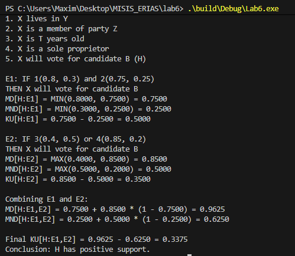

# Лабораторная работа №6

Экспертная система: расчёт мер доверия (MD), недоверия (MND) и коэффициента уверенности (KU) по формуле Шортлиффа.

## Сборка и запуск

В терминале из папки `Lab6`:

```powershell
cmake -S . -B build
cmake --build build --config Debug
.\build\Debug\Lab6.exe
```

## Скриншоты работы программы

